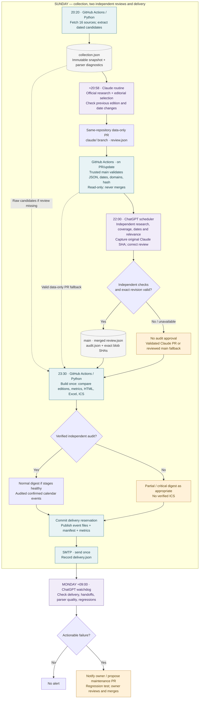

# Institutional Radar

Institutional Radar is a weekly economic-intelligence agenda for Italian and international institutional publications. It combines deterministic collection, two independent research stages, a concise Italian email digest, a broad Excel calendar and calendar-import links.

## What it monitors

Sixteen institutions: ISTAT, Eurostat, INPS, Ministry of Labour (MLPS), INAPP, Unioncamere, INAIL, ILO, Banca d’Italia, MEF, OECD, World Bank, CNEL, ADAPT, Fondazione Studi Consulenti del Lavoro and DG EMPL. Editorial priorities are labour markets, wages, productivity, households and consumption, services/trade/tourism, key macroeconomic and demographic releases, and poverty measurement. See [editorial policy](config/editorial.md) and [source configuration](config/sources.json).

## Weekly workflow

All times are **Europe/Rome** (local time, including daylight saving). The weekly ID is Sunday YYYY-MM-DD; the research horizon begins the following Monday and covers 30 days.



| When | Executor | Result |
| --- | --- | --- |
| Sunday 20:20 | GitHub collection | Immutable candidate snapshot |
| Sunday ~20:58 | Claude routine | Reviewed data-only pull request |
| On PR/update | GitHub validation and CI | Structural checks against trusted collection |
| Sunday 22:00 | ChatGPT audit | Independent evidence check, validated data merge, exact-hash approval |
| Sunday 23:30 | GitHub finalization | HTML digest + Excel + optional verified ICS; reservation and SMTP receipt |
| Monday ~09:00 | ChatGPT watchdog / maintenance | Alert on missing delivery or actionable issue; separate maintenance PR if reproducible |

External schedulers and GitHub jobs may start late. The finalizer handles missing stages without inventing approval; the Monday check covers even a finalizer that never started. Neither AI agent sends mail. Public research artifacts, not private email or personal calendars, are the handoff.

## Data collection and editorial policy

| Institution | Structured adapter |
| --- | --- |
| ISTAT | Official press iCalendar and discovery of additional public feeds |
| Eurostat | Official release-calendar iCalendar |
| INPS | Observatory calendar HTML table |
| MLPS | Annual SISCO calendar PDF (pdftotext) |
| Banca d’Italia | Monthly agenda HTML |
| Other sources | Official candidate links and independent research |

Python candidates are leads, not approved events. Claude researches official calendars and off-calendar announcements, and selects useful high/medium events for days 1–7, 8–21 and 22–30. ChatGPT independently audits omissions, dates and evidence. Calendar-only discoveries are preserved without cluttering the email.

## What arrives

- **HTML digest:** numbered items, official links, date certainty, relevance, and **NEW / ALREADY REPORTED / POSTPONED / ADVANCED / DATE TO VERIFY** markers (in Italian), compared with the last sent nonempty edition.
- **Excel workbook (`calendario-completo.xlsx`):** three sheets — Calendario, Variazioni, Metriche — with real calendar dates, filters and native clickable source / Google Calendar / Outlook / individual ICS links where available. CSV remains a machine-readable workflow artifact, not a mail attachment.
- **ICS:** confirmed, audited, high-relevance events in a bulk file; confirmed audited high/medium editorial items can have individual ICS downloads. Unverified raw candidates have clearly labelled draft links only. Cancelled or superseded dates are not offered for import. A cancellation or reschedule is confirmed only with official evidence. Silence does not prove cancellation; exact-title date conflicts are flagged for verification. Previously imported items are not automatically deleted or modified in the recipient's calendar.
- **Metrics:** distinct Python candidates, Claude selections and unmatched additions, final audit additions/removals/changed fields, final selected count. The audit records the exact pre-edit Claude commit where possible; unknown counts stay unknown. Matching uses normalized institution/date/title and measures recorded differences, not causal credit or truth.
- **Health:** stage handoffs, parser quality, and coverage gaps. A missing/invalid stage produces a partial digest; two consecutive recorded missing handoffs trigger a critical header. Parser quality is reported separately, not misrepresented as a failed agent. No stale previous collection is substituted.

## Repository layout

```
.github/workflows/  Collection, trusted PR validation, CI, parser smoke, finalization
agents/             Canonical review, audit and maintenance contracts
config/             Source configuration and editorial policy
data/YYYY-MM-DD/    Immutable collection, review, audit, health, delivery, manifest, metrics
src/                Collection, validation, history, metrics, rendering, spreadsheet, delivery
tests/fixtures/     Small public source-format regression samples
tests/              Offline unit and integration tests
docs/               Architecture and operating notes
```

## Running locally

Python 3.12 recommended; install Poppler's pdftotext for the SISCO adapter.

```bash
python -m pip install -r requirements.txt
python -m unittest discover -s tests -v
python -m src.parser_smoke
python -m src.radar collect --date YYYY-MM-DD --demo
python -m src.radar demo-review --date YYYY-MM-DD
python -m src.radar validate --date YYYY-MM-DD
python -m src.radar finalize --date YYYY-MM-DD
```

Use an unused Sunday ID for a demo, and never send synthetic events. Omit --demo for live collection. Existing snapshots are immutable. Local previews are written to output/; smoke probes save bounded public format excerpts for regression review.

## Configuration and deployment

Create repository Actions secrets SMTP_USER, SMTP_PASSWORD and NOTIFY_TO. Set repository variables ENABLE_SCHEDULE=true and ENABLE_EMAIL=true for scheduled collection/finalization and SMTP. SMTP_HOST and SMTP_PORT are optional (defaults smtp.gmail.com / 465, SSL). No automatic-merge variable is required; the trusted validation workflow is read-only. Configure the Claude routine to read agents/review.md and the ChatGPT audit to read agents/audit.md; the Monday watchdog follows agents/maintenance.md. The contracts in main are the source of truth.

Manual preview: run finalization with send=false and test_email=false. For a labelled test email use an already reviewed live Sunday ID with send=false and test_email=true. Tests do not modify production receipts or publish individual ICS links. Production delivery is blocked for future Sunday IDs and never repeats a sent run.

## Integrity and limitations

PR validation never executes PR code. Only the independent auditor may accept the exact validated data PR, not maintenance changes. A reservation is committed before SMTP and binds the rendered files; ambiguous attempts require inspection, not automatic retry. Source failures, unavailable schedules, changing site formats, and approximate matching can leave gaps. A healthy workflow is not proof of exhaustive coverage or inbox receipt. No credentials or personal information belong in this public repository.

See [architecture](docs/architecture.md), [review](agents/review.md), [audit](agents/audit.md) and [maintenance](agents/maintenance.md).
