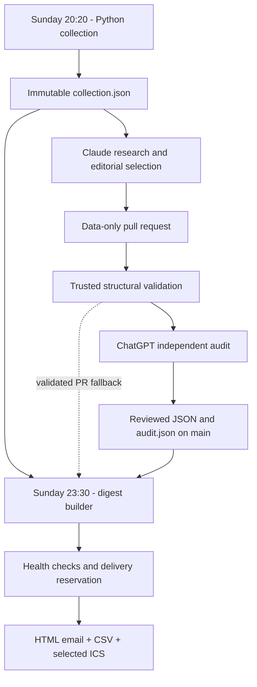

# Institutional Radar

Institutional Radar is an automated economic-intelligence agenda. It monitors scheduled releases, reports and presentations from Italian and international institutions, combines structured calendar extraction with independent research, and delivers a concise weekly digest plus a broader calendar export.

## What it monitors

Sixteen institutions: ISTAT, Eurostat, INPS, Ministry of Labour (MLPS), INAPP, Unioncamere, INAIL, ILO, Banca d’Italia, MEF, OECD, World Bank, CNEL, ADAPT, Fondazione Studi Consulenti del Lavoro and DG EMPL. The editorial focus is labour markets, wages, productivity, households and consumption, services/trade/tourism, key macroeconomic and demographic releases, and poverty measurement. See [editorial policy](config/editorial.md) and [source configuration](config/sources.json).

## Weekly architecture



Times are Europe/Rome. Claude's routine runs around 20:58 and the audit around 22:00. Stages communicate through public research artifacts in GitHub, not private email or personal accounts.

## Data collection

| Institution | Structured adapter |
| --- | --- |
| ISTAT | Official press iCalendar and additional public feed discovery |
| Eurostat | Official release-calendar iCalendar |
| INPS | Observatory calendar HTML table |
| MLPS | Annual SISCO calendar PDF using pdftotext |
| Banca d’Italia | Monthly agenda HTML |
| Other sources | Official candidate links and agent research |

The collector retains dated candidates and per-source diagnostics. Candidates are not approved events. The reviewer independently searches calendars, newsrooms and announcements outside the calendar, and creates a selective Italian digest for days 1–7, 8–21 and 22–30. The independent auditor checks omissions, dates, source evidence and relevance and records the exact Git blob hashes of the reviewed artifacts.

## Output and operational health

- **HTML digest:** selected releases with date, institution, relevance, concise explanation and official link.
- **Full calendar CSV:** all dated candidates retrieved from structured sources, plus selected research results. Distinguishes raw leads, tentative dates and reviewed dates; not a claim of complete coverage of every institution.
- **ICS:** high-relevance, confirmed selected events only, after a valid independent audit. Empty calendars are not attached to email.
- **Operational checks:** collection, Claude handoff and ChatGPT audit; missing or unverifiable deliveries are counted across successive recorded weeks. A first missing stage produces a partial digest; two consecutive weeks without a verifiable handoff trigger a critical subject and header. The system does not infer subscription exhaustion from absent files.
- If Claude or the audit is missing, delivery continues with a clearly labelled partial digest. If both are missing, the email can carry diagnostics and raw calendar candidates without claiming an editorial review. No previous week's data are substituted for a missing current collection.

## Repository layout

```
.github/workflows/  CI, collection, structural PR validation, live probes, digest
agents/             Review, independent audit, maintenance contracts
config/             Sources and editorial policy
data/YYYY-MM-DD/    Weekly collection, review, audit, health, delivery record
src/                Collectors, adapters, validation, rendering, delivery
tests/              Unit tests
docs/               Architecture and operating notes
```

## Running locally

Python 3.12 recommended; install Poppler's pdftotext for the SISCO adapter. From the repository root:

```bash
python -m unittest discover -s tests -v
python -m src.parser_smoke
python -m src.radar collect --date YYYY-MM-DD --demo
python -m src.radar demo-review --date YYYY-MM-DD
python -m src.radar finalize --date YYYY-MM-DD
```

Use a Sunday run ID. Omit --demo for live collection; existing snapshots are immutable and repeat collection of the same mode is a no-op. Local previews are written to output/. The live smoke test probes sources without modifying snapshots.

## Configuration and deployment

Create repository Actions secrets SMTP_USER, SMTP_PASSWORD and NOTIFY_TO. Set repository variable ENABLE_SCHEDULE=true to enable collection and scheduled finalization. Set ENABLE_EMAIL=true to enable live SMTP delivery. SMTP_HOST and SMTP_PORT are optional (defaults smtp.gmail.com / 465, SSL). Configure the Claude routine against this repository and the ChatGPT audit against agents/audit.md. Neither agent sends email. Manual preview: run the finalization workflow with send=false.

## Integrity and limitations

Structural PR validation runs trusted main code, never PR code. Live PR acceptance is handled by the independent auditor. Missing audit never masquerades as approval; no calendar attachment of unverified events. A delivery reservation is committed before SMTP and binds the exact rendered bytes; ambiguous attempts require inspection before retry. The public repository must never contain credentials or personal information. A source may block access, change its format or publish no date. Scheduled execution can be delayed or missed; GitHub failure notifications remain a separate safety net if the finalization workflow itself fails. The editorial digest is not a replacement for official calendars.

See [architecture](docs/architecture.md), [review contract](agents/review.md) and [audit contract](agents/audit.md).
